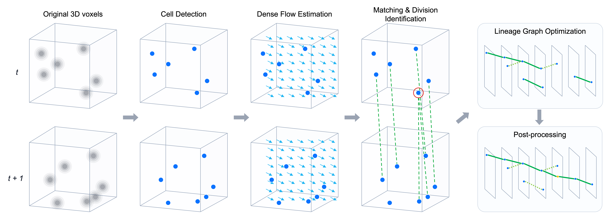

# Biohub - Cell Tracking During Development - 3rd Place Solution

English | [日本語](README_JP.md)

This is the implementation of the 3rd place solution for [Biohub - Cell Tracking During Development](https://www.kaggle.com/competitions/biohub-cell-tracking-during-development) at Kaggle.
The solution is described in [this writeup](https://www.kaggle.com/competitions/biohub-cell-tracking-during-development/writeups/3rd-place-solution). See also [SOLUTION.md](SOLUTION.md) for the method description and ablation results.

Paper: [Learning to Track Cells from Sparse Annotations in 3D Time-Lapse Microscopy](https://arxiv.org/abs/2611.06624).



Trained weights and calibration models for this reproduction package are publicly available in the [Kaggle dataset](https://www.kaggle.com/datasets/ren4yu/biohub-sub046-artifacts/). See Section 2.1 for download and setup instructions.

Inference on the competition test data runs in the public [Kaggle notebook](https://www.kaggle.com/code/ren4yu/biohub-inference-run). It uses the same stack as 046 v4 without detection flip TTA, with TensorRT engines on T4 GPUs (private 0.96918 / public 0.97832, late submission).

This repository contains a self-contained package for training, inference, and evaluation of the final submission, **046 v4** (private LB 0.967).
A single `docker compose run` command runs training, out-of-fold inference on all 199 training videos, calibration, lineage optimization and post-processing, and evaluation with the official metric.
The final output is the **five-fold OOF score over all 199 training videos**; the reference score for 046 v4 is 0.977800677.
Reproduction targets this OOF evaluation because the hidden test images and ground truth are unavailable.

## 1. Requirements

- Linux and an NVIDIA GPU with at least 24 GB VRAM; 32 GB is recommended for training. Install Docker Engine, Docker Compose v2, and the [NVIDIA Container Toolkit](https://docs.nvidia.com/datacenter/cloud-native/container-toolkit/latest/install-guide.html). On Ubuntu, `sudo bash scripts/install_docker_ubuntu.sh` installs these components.
  The PyTorch wheel includes the CUDA 12.8 runtime, so the host only needs a compatible NVIDIA driver (version 570 or later).
- Competition data in `input/`: 199 pairs of `train/<id>.zarr` and `train/<id>.geff`, approximately 81 GB. The default location is `input/` in this repository. Set `INPUT_DIR=/path/to/input` to use another location.
- Disk space: approximately 15 GB for models, 35 GB for training caches (including 29 GB of dense flow), several GB for OOF caches, and 1 GB for pretrained weights from Hugging Face.
- Network access for the initial build and training setup to download dependencies and the ImageNet weights used by timm.

## 2. Running the Pipeline

```bash
docker compose build
docker compose run --rm solution            # = python -m biohub046.pipeline all
```

Stages run in order. **Stages with complete outputs are skipped**, so rerunning the command resumes an interrupted run.
A model is written to `artifacts/models/` only after its training finishes. Detector and matcher training resumes from the last epoch saved under `cache/train/`; an interrupted flow or division model is retrained from the start.

| # | Stage | Description | Output | Estimated time (one RTX 5090) |
|---|---|---|---|---|
| 1 | `prepare` | Assign folds and cache DoG detections for the detector's masked loss | `cache/folds.json`, `cache/det_cache/` | 2 min |
| 2 | `train_det` | Train detectors dl_284 / dl_275 / dl_492 across five folds | `artifacts/models/dl_{284,275,492}/` | ≈ 45 h |
| 3 | `train_flow` | Train dense flow model flow_164 | `artifacts/models/flow_164/` | ≈ 20–40 h |
| 4 | `train_caches` | Prepare matcher / div3f training inputs: OOF detections from the two-model ensemble and 29 GB of dense flow | `cache/champion_dets/`, `cache/dense_flow/` | ≈ 2 h |
| 5 | `train_matcher` | Train matcher dl_401 across five folds | `artifacts/models/dl_401/` | ≈ 3 h |
| 6 | `train_div3f` | Train division models div_415 / div_478 pre and post / div_762 across five folds (`calpick` checkpoints) | `artifacts/models/div3f/` | ≈ 10–15 h |
| 7 | `oof_infer` | Infer all 199 videos with their held-out fold models: detection → matcher/flow → LP wiring → division scores → radius-16 candidates | `cache/oof/` | ≈ 10–15 h |
| 8 | `calibrate` | Train ordinary-link and division (native / wide) calibrators for each fold and for the full dataset | `artifacts/calibrators/{fold0..4,full}/` | 10 min |
| 9 | `optimize` | Calibrated predictions → three rounds of pooled LP optimization (797 initialization) → gap closing / short-component removal → affine coordinate refinement A6 + A7 | `cache/lineage/`, `cache/final_graphs/` | 1–2 h (CPU) |
| 10 | `score` | Evaluate all videos with the official Royer Lab metric and report pooled scores | `cache/score.json` | 10 min |

The total estimate is approximately 100–120 GPU hours. On hosts with multiple GPUs, `oof_infer` automatically distributes work across the visible GPUs.

### 2.1 Skipping Training with Pretrained Weights

Place checkpoints in `artifacts/models/` using the names below to skip training of the corresponding models. If all matcher and div3f checkpoints are present, `train_caches` is also skipped.

```text
artifacts/models/dl_284/dl_284_fold{0..4}_last.ckpt     artifacts/models/dl_275/dl_275_fold{0..4}_last.ckpt
artifacts/models/dl_492/dl_492_fold{0..4}_last.ckpt     artifacts/models/dl_401/dl_401_fold{0..4}_last.ckpt
artifacts/models/flow_164/ssl_flow_flow_164_ep48.pt
artifacts/models/div3f/div_415_f{0..4}_calpick.pt
artifacts/models/div3f/div_478_pre_fold{0..4}_calpick.pt
artifacts/models/div3f/div_478_post_fold{0..4}_calpick.pt
artifacts/models/div3f/div_762_f{0..4}_calpick.pt
```

The weights used for the submission and the calibrators trained with this package are bundled in the Kaggle dataset [`ren4yu/biohub-sub046-artifacts`](https://www.kaggle.com/datasets/ren4yu/biohub-sub046-artifacts) (7.3 GB).
Extract it into `artifacts/` to skip the five training/preparation stages and `calibrate`, and run inference and evaluation from `oof_infer` onward.

```bash
kaggle datasets download -d ren4yu/biohub-sub046-artifacts -p artifacts --unzip   # artifacts/models, artifacts/calibrators
```

Detector and matcher checkpoints have been reduced to inference essentials using `scripts/slim_artifacts.py`: model weights (EMA weights when available) and `hyper_parameters`. Their predictions match those from the full training checkpoints.

The `calibrate` stage is skipped when all directories in `artifacts/calibrators/{fold0..4,full}/` are present.
The `full/` directory corresponds to the submission bundle `models-biohub-calib047`: fold −1, trained on all 199 videos.

### 2.2 Options

```bash
docker compose run --rm solution oof_infer            # Run a single stage from the table above
docker compose run --rm solution all --from calibrate # Run from this stage to the end
BIOHUB_LIMIT=10 docker compose run --rm solution all --from oof_infer   # Run stages 7–10 on the first 10 videos (replaces calibrators and lineage outputs; see below)
docker compose run --rm solution all --smoke          # Smoke run: 12 videos, 1–2 epochs (see below)
CUDA_VISIBLE_DEVICES=0 docker compose run --rm solution all             # Restrict visible GPUs
DOCKER_UID=$(id -u) DOCKER_GID=$(id -g) docker compose run --rm solution  # Write files as the host user (default: root)
BIOHUB_JOBS=8 docker compose run --rm solution optimize                 # CPU workers (default: 4)
INPUT_DIR=/data/biohub/input ARTIFACTS_DIR=/data/biohub/artifacts CACHE_DIR=/data/biohub/cache docker compose run --rm solution
```

`--smoke` runs every stage on a subset of 12 videos with 1–2 training epochs to check execution paths and checkpoint formats. `BIOHUB_SMOKE=1` is equivalent.
Outputs are isolated under `cache/smoke/`, leaving the main `artifacts/` directory untouched. Scores from this run are not meaningful. Some calibration heads have no training rows with the barely trained models, so the smoke run substitutes constant models for those heads.

`--limit` applies to `oof_infer`, `calibrate`, `optimize`, and `score`; the training stages and their caches always use all videos.
The stages from `calibrate` onward depend on the video set: calibrators are trained across the selected videos, and LP optimization pools counts across exactly those videos, even if caches of other videos exist. Changing `--limit` causes the calibrators, LP outputs, and final graphs to be rebuilt in place, as determined by `artifacts/calibrators/manifest.json` and `cache/lineage/manifest.json`; a later run without `--limit` rebuilds them for all videos. To keep the full-set calibrators, run the trial on copies of `artifacts/` and `cache/` (`ARTIFACTS_DIR` / `CACHE_DIR`).
The per-video `oof_infer` caches are reused.

To run without Docker, use `uv sync --frozen`, then `./run.sh all` (equivalent to `uv run python -m biohub046.pipeline all`).
Set paths with the environment variables `BIOHUB_INPUT_DIR`, `BIOHUB_ARTIFACTS_DIR`, and `BIOHUB_CACHE_DIR`.
Docker and the source tree are the supported ways to run the package. A wheel built from `pyproject.toml` does not include the official metric code in `third_party/`, so scoring fails outside the source tree.

## 3. Outputs

The pipeline prints a score table and writes `cache/score.json`, containing overall, per-embryo, and per-fold scores, along with per-video counts.

```text
  sub 046 v4 reproduction — official metric, 199 train movies, out-of-fold
       all: score 0.97xxxx  (adj_edge 0.92xxxx, div_j 0.5xxx, edge TP/FP/FN ..., div TP/FP/FN ..., n=199)
      44b6: ...
      6bba: ...
  reference (046 v4, all 199 OOF):  0.977801
```

The competition score is `adjusted edge Jaccard + 0.1 × division Jaccard`.
Adjusted edge Jaccard is the TP+FP+FN-weighted average of `max(0, J·(1 − 0.1·(n_pred − n_total)/n_total))` across videos; division Jaccard is micro-averaged.
Evaluation directly calls the organizers' `tracking_cellmot` implementation, included under `third_party/` (BSD-3-Clause, commit `016845f`).

### 3.1 Validation Results (2026-10-01, One RTX 5090)

With the submission checkpoints (15 detectors + 5 matchers + 1 flow model + 20 division models) placed in `artifacts/models/`, we skipped training and ran `oof_infer` (2.6 h) → `calibrate` (6 min) → `optimize` (7 min) → `score`.
Results are saved in `reports/oof_score_2026-10-01.json`.

| | score | adj_edge | div_j | edge TP / FP / FN | div TP / FP / FN |
|---|---:|---:|---:|---|---|
| This reproduction | **0.976153** | 0.923493 | 0.5266 | 122313 / 3657 / 6570 | 99 / 37 / 52 |
| 046 v4 reference | 0.977801 | 0.923790 | 0.5401 | 122610 / 3643 / 6273 | 101 / 36 / 50 |

Per-embryo scores are 0.9558 for 44b6 (n=71) and 0.9806 for 6bba (n=128).
The −0.0016 difference comprises approximately −0.0003 in the edge term and −0.0135 × 0.1 in the division term, arising from the calibration-row definition and detection-path blur differences described in Section 5, items 2–3.
Per-video edge counts are close to the reference; for example, the first ten videos have total TP/FP/FN of 1873/52/83, compared with 1884/65/72 in the reference.

Docker validation on the same host (2026-10-05): `docker compose run --rm solution all --smoke` completed all ten stages, including the five training/preparation stages, in approximately 25 minutes.
For two videos using the submission weights, all four output types from `oof_infer` inside the container exactly matched the host caches. Running `score` inside the container also produced 0.976153.

## 4. Pipeline Configuration (046 v4)

| Stage | Description |
|---|---|
| ① Detection | Weighted heatmap ensemble of 2.5D U-Nets (EfficientNetV2-L / EfficientNet-B7, three z-slice inputs) and 3D SegResNet, with weights 0.3 / 0.4 / 0.3. Two-view flip TTA, fp16, Gaussian blur with σ=0.7, NMS (3,7,7), and threshold 0.2. Training uses Gaussian regression at GT centers, loss masks around DoG candidates, and EMA. |
| ② Flow / matcher | Self-supervised 3D flow on a [1,4,4] grid (flow_164) corrects candidate positions. A siamese 2.5D trunk and cross-attention matcher (dl_401) compute forward, reverse, and symmetric correspondence scores. Candidate graphs use the production-cell Hungarian assignment, a second round, and global LP wiring. |
| ④ Division | Three-frame 2.5D models: parent div_415 and pre / post div_478, plus the native parent div_762 with five inputs including images aligned by flow. Four-rotation TTA and additional daughter candidates within radius 16. |
| Calibration | Ordinary links: logistic models with 26 features for conditional correctness and exposure, plus priors. Divisions: a logistic model with 19 features, followed by residual LightGBM (797) and XGBoost (846) models with 34 features; their probabilities are averaged 50:50. Separate models are used for native and wide candidates. |
| Optimization | Joint selection of ordinary links, divisions, and nodes using LP, with coefficients obtained by linearizing the official metric over expected TP, FP, and node counts. HiGHS solves the LP, followed by MILP if fractional decisions remain. Three rounds start from the 797 initialization, with coefficients shared across videos. |
| Post-processing | Gap closing (1–3 missing frames, gate `3√(g+1)` µm) → removal of components with fewer than six nodes → affine refinement of detected coordinates weighted by q (A6) → affine refinement of interpolated gap coordinates (A7). |

For OOF evaluation, each video's detectors, matcher, division models, and calibrators are trained with its fold excluded. The division checkpoint of each fold is selected by validation metrics on that fold, which contains the evaluated video. The dense flow model (flow_164) is a single model shared by all folds, trained on its own split of 179 training and 20 validation videos. The LP coefficients are pooled across all 199 videos. These conditions match the 046 v4 OOF evaluation (`exp_846`).
Submission inference averaged the five fold models and used calibrators trained on the full dataset (`full/`).

## 5. Differences from the Original Submission

1. The submission used TensorRT fp16 engines for detection (15 engines) and division (40 engines). This package uses PyTorch fp16 autocast throughout. In validation on Kaggle T4 GPUs, the CSV before affine refinement matched the PyTorch version.
2. Retraining can produce different weights because of random seeds and GPU differences, so it does not exactly reproduce 0.977800677. Even with the provided weights, the division calibration rows have been redefined using the inference candidate sets. The original 797 rows came from the experimental pipeline and included nine legacy initialization exceptions. The new native pool has 134,063 rows / 106 positives, and the wide pool has 179,290 / 117, compared with 137,933 / 108 and 183,799 / 120 originally. These differences affect the third decimal place of the score (Section 3.1).
3. OOF inference follows the submission code path: fp16, blur 0.7, and encoder feature reuse. This differs from the research OOF pipeline used for the reference score, including its export precision (bf16).

## 6. Directory Layout

```text
biohub046/
  pipeline.py           Stage order, skipping, --smoke / --limit
  config.py             Paths (environment variables), fold assignment, constants
  core/                 Data, models, losses, LP formulation, coordinate refinement
  ssl_flow/, div3f/     Flow and division model training/inference
  train/                Training recipes for detection, flow, matcher, and div3f
  caches/               DoG detections, two-model OOF detection cache, dense flow cache
  infer/                Per-video inference adapted for held-out fold models (oof_infer.py)
  lineage/              Calibration, prediction, LP (div846), gap closing, affine refinement
  calibrate.py, score.py
third_party/tracking_cellmot/   Official metric implementation (BSD-3-Clause)
tests/                  uv run pytest
```

### Naming

Identifiers such as `dl_401`, `div_762`, `flow_164`, `exp_846`, and the numbers in module names (`div797_*`, `div846_lineage`) are internal experiment IDs from development. They are kept so that file names, configuration keys, and the published weights stay consistent. The numbers carry no meaning beyond identifying an experiment. `biohub046` refers to the final submission, 046 v4.

## 7. Citation

If you find this work or code useful in your research, please consider citing the following paper:

```bibtex
@misc{uchida2026learningtrackcells,
  title         = {Learning to Track Cells from Sparse Annotations in {3D} Time-Lapse Microscopy},
  author        = {Uchida, Yusuke},
  year          = {2026},
  eprint        = {2611.06624},
  archivePrefix = {arXiv},
  primaryClass  = {cs.CV},
  url           = {https://arxiv.org/abs/2611.06624}
}
```
