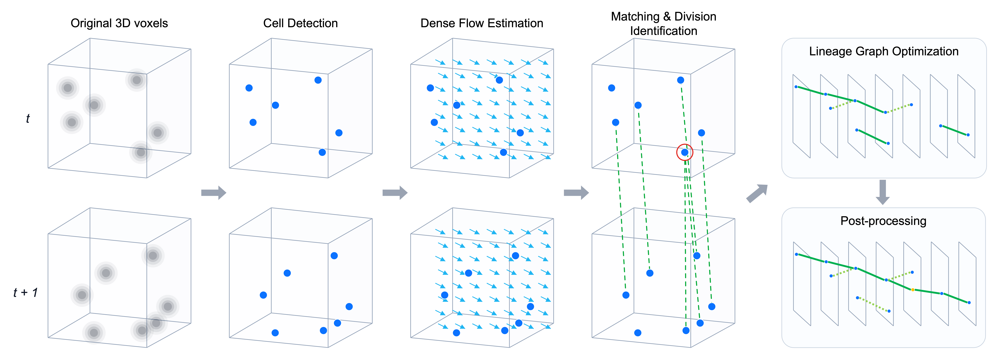

# Biohub - Cell Tracking During Development - 3rd Place Solution

[English](README.md) | 日本語

Kaggle [Biohub - Cell Tracking During Development](https://www.kaggle.com/competitions/biohub-cell-tracking-during-development) の 3 位解法の実装です。
解法は [writeup](https://www.kaggle.com/competitions/biohub-cell-tracking-during-development/writeups/3rd-place-solution) で解説しています。手法の解説と ablation 結果は [SOLUTION.md](SOLUTION.md) も参照してください。

論文: [Learning to Track Cells from Sparse Annotations in 3D Time-Lapse Microscopy](https://arxiv.org/abs/2611.06624)。



学習済み重みと再現用の較正器は、[Kaggleデータセット](https://www.kaggle.com/datasets/ren4yu/biohub-sub046-artifacts/)で公開しています。ダウンロード・配置手順は §2.1 を参照してください。

コンペのテストデータに対する推論は、公開の[Kaggleノートブック](https://www.kaggle.com/code/ren4yu/biohub-inference-run)で実行できます。046 v4 から検出の flip TTA を外し、T4 GPU 上の TensorRT engine で動かす構成です（private 0.96918 / public 0.97832、late submission）。

最終提出 **046 v4**（private LB 0.967）のモデル学習・推論・評価を、このリポジトリだけで再現する自己完結コードです。
`docker compose run` 一発で「学習 → 全 199 学習動画の out-of-fold 推論 → 較正器学習 → 系譜最適化・後処理 →
公式指標で採点」が走り、最後に **train 199 本の 5-fold OOF スコア**（046 v4 の参照値 0.977800677）を表示します。
テストデータは GT もデータも非公開のため、再現の対象はこの OOF 評価です。

## 1. 前提

- Linux + NVIDIA GPU（VRAM 24 GB 以上、学習は 32 GB 推奨）。Docker Engine、Docker Compose v2、
  [NVIDIA Container Toolkit](https://docs.nvidia.com/datacenter/cloud-native/container-toolkit/latest/install-guide.html)
  （Ubuntu なら `sudo bash scripts/install_docker_ubuntu.sh` で一括導入）。
  CUDA ランタイムは torch の wheel（CUDA 12.8）に同梱されているので、ホストには対応ドライバ（≥ 570）だけが必要です。
- コンペデータ `input/`（`train/<id>.zarr` と `train/<id>.geff` が 199 本、約 81 GB）。既定ではこのリポジトリ直下の
  `input/` を使います。別の場所なら `INPUT_DIR=/path/to/input` を渡します。
- ディスク: モデル 15 GB、学習用キャッシュ ≈ 35 GB（dense flow 29 GB）、OOF キャッシュ数 GB、HF の事前学習重み 1 GB。
- 初回ビルドと学習時にネットワークが必要です（pip 依存、timm の ImageNet 事前学習重み）。

## 2. 実行

```bash
docker compose build
docker compose run --rm solution            # = python -m biohub046.pipeline all
```

段は順に実行され、**出力がすでに揃っている段はスキップ**されます（途中で止めても再実行で続きから）。
モデルは学習が最後まで終わってから `artifacts/models/` に書き出されます。detector と matcher は `cache/train/` に保存された最新 epoch から学習を再開し、flow と分裂モデルは中断したモデルを最初から学習し直します。

| # | 段 | 内容 | 出力 | 目安（RTX 5090 1 枚） |
|---|---|---|---|---|
| 1 | `prepare` | fold 割り当て、DoG 検出キャッシュ（検出器の carved loss 用） | `cache/folds.json`, `cache/det_cache/` | 2 分 |
| 2 | `train_det` | 検出器 dl_284 / dl_275 / dl_492 × 5 fold | `artifacts/models/dl_{284,275,492}/` | ≈ 45 h |
| 3 | `train_flow` | dense flow flow_164 | `artifacts/models/flow_164/` | ≈ 20〜40 h |
| 4 | `train_caches` | matcher / div3f の学習入力（2 メンバー OOF 検出キャッシュ、dense flow キャッシュ 29 GB） | `cache/champion_dets/`, `cache/dense_flow/` | ≈ 2 h |
| 5 | `train_matcher` | matcher dl_401 × 5 fold | `artifacts/models/dl_401/` | ≈ 3 h |
| 6 | `train_div3f` | 分裂モデル div_415 / div_478 pre・post / div_762 × 5 fold（calpick） | `artifacts/models/div3f/` | ≈ 10〜15 h |
| 7 | `oof_infer` | 全 199 動画を fold-matched モデルで推論（検出 → matcher/flow → LP wiring → 分裂スコア → radius16 候補） | `cache/oof/` | ≈ 10〜15 h |
| 8 | `calibrate` | 通常リンク・分裂（native / wide）の較正器を fold 別 + 全体で学習 | `artifacts/calibrators/{fold0..4,full}/` | 10 分 |
| 9 | `optimize` | 較正予測 → 3 round のプール LP（797 seed）→ gap closing / 短成分除去 → affine 座標補正 A6 + A7 | `cache/lineage/`, `cache/final_graphs/` | 1〜2 h（CPU） |
| 10 | `score` | 公式指標（royerlab 実装）で全動画を採点し、プール値を表示 | `cache/score.json` | 10 分 |

合計 ≈ 100〜120 GPU 時間。GPU を複数積んだホストでは `oof_infer` が可視 GPU 数で自動的に並列化されます。

### 2.1 学習をスキップする（学習済み重みの配置）

`artifacts/models/` に下記の名前でチェックポイントを置くと、該当モデルの学習（と、matcher / div3f が全部ある場合は
`train_caches`）がスキップされて推論・評価に進みます。

```
artifacts/models/dl_284/dl_284_fold{0..4}_last.ckpt     artifacts/models/dl_275/dl_275_fold{0..4}_last.ckpt
artifacts/models/dl_492/dl_492_fold{0..4}_last.ckpt     artifacts/models/dl_401/dl_401_fold{0..4}_last.ckpt
artifacts/models/flow_164/ssl_flow_flow_164_ep48.pt
artifacts/models/div3f/div_415_f{0..4}_calpick.pt
artifacts/models/div3f/div_478_pre_fold{0..4}_calpick.pt
artifacts/models/div3f/div_478_post_fold{0..4}_calpick.pt
artifacts/models/div3f/div_762_f{0..4}_calpick.pt
```

提出に使った重みと、このパッケージで学習した較正器は Kaggle データセット
[`ren4yu/biohub-sub046-artifacts`](https://www.kaggle.com/datasets/ren4yu/biohub-sub046-artifacts)（7.3 GB）にまとめてあります。
`artifacts/` に展開すれば学習 5 段と `calibrate` がスキップされ、`oof_infer` 以降だけが走ります。

```bash
kaggle datasets download -d ren4yu/biohub-sub046-artifacts -p artifacts --unzip   # artifacts/models, artifacts/calibrators
```

検出器と matcher のチェックポイントは推論用に slim 化したもの（EMA があれば EMA の重み + `hyper_parameters` のみ、
`scripts/slim_artifacts.py`）で、学習直後のフル版と推論結果は一致します。

同様に `artifacts/calibrators/{fold0..4,full}/` が揃っていれば `calibrate` がスキップされます。
`full/` が提出バンドル `models-biohub-calib047` 相当（fold = −1、199 本全部で学習）です。

### 2.2 オプション

```bash
docker compose run --rm solution oof_infer            # 単段実行（段名は上表）
docker compose run --rm solution all --from calibrate # ある段から最後まで
BIOHUB_LIMIT=10 docker compose run --rm solution all --from oof_infer   # 先頭 10 動画だけで 7〜10 を通す（動作確認。較正器と系譜出力を置き換える、下記）
docker compose run --rm solution all --smoke          # 12 動画・1〜2 epoch のスモーク（下記）
CUDA_VISIBLE_DEVICES=0 docker compose run --rm solution all             # GPU を限定
DOCKER_UID=$(id -u) DOCKER_GID=$(id -g) docker compose run --rm solution  # 出力をホストユーザー所有にする（既定は root）
BIOHUB_JOBS=8 docker compose run --rm solution optimize                 # CPU ワーカー数（既定 4）
INPUT_DIR=/data/biohub/input ARTIFACTS_DIR=/data/biohub/artifacts CACHE_DIR=/data/biohub/cache docker compose run --rm solution
```

`--smoke` は 12 動画の部分集合に対して全段を 1〜2 epoch で通し、コード経路とチェックポイント形式を確認します。`BIOHUB_SMOKE=1` でも同じです。
成果物は `cache/smoke/` 以下に隔離され、本番の `artifacts/` には触れません（スコアは意味を持ちません。未学習モデルでは
行が無い較正ヘッドが出るので、smoke だけは定数モデルで代替します）。

`--limit` が効くのは `oof_infer` / `calibrate` / `optimize` / `score` で、学習段とその入力キャッシュは常に全動画を使います。
`calibrate` 以降の段は動画集合に依存する（較正器は選んだ動画で学習し、LP は他の動画のキャッシュがあっても選んだ動画だけでプールする）ため、
`--limit` を変えて再実行すると較正器・LP・最終グラフはその場で作り直されます（`artifacts/calibrators/manifest.json`, `cache/lineage/manifest.json` で判定）。
後で `--limit` なしで実行すれば全動画で作り直されます。全動画の較正器を残したい場合は、`artifacts/` と `cache/` のコピーに対して
（`ARTIFACTS_DIR` / `CACHE_DIR` で指定）試運転してください。
`oof_infer` のキャッシュは動画ごとなので再利用されます。

docker なしで実行する場合は `uv sync --frozen` の後 `./run.sh all`（`uv run python -m biohub046.pipeline all` と同じ）。
パスは環境変数 `BIOHUB_INPUT_DIR` / `BIOHUB_ARTIFACTS_DIR` / `BIOHUB_CACHE_DIR` で変えられます。
サポートする実行方法は docker とソースツリーからの実行です。`pyproject.toml` から作る wheel には `third_party/` の公式評価コードが含まれないため、ソースツリー外では採点できません。

## 3. 出力

最終出力は標準出力の表と `cache/score.json`（全体・胚別・fold 別のスコア、各動画のカウント）です。

```
  sub 046 v4 reproduction — official metric, 199 train movies, out-of-fold
       all: score 0.97xxxx  (adj_edge 0.92xxxx, div_j 0.5xxx, edge TP/FP/FN ..., div TP/FP/FN ..., n=199)
      44b6: ...
      6bba: ...
  reference (046 v4, all 199 OOF):  0.977801
```

`score = adjusted edge Jaccard + 0.1 × division Jaccard`（コンペ定義。adjusted edge Jaccard は動画ごとの
`max(0, J·(1 − 0.1·(n_pred − n_total)/n_total))` の TP+FP+FN 加重平均、division Jaccard はマイクロ平均）。
採点は主催者実装 `tracking_cellmot`（`third_party/`、BSD-3-Clause、commit `016845f`）をそのまま呼びます。

### 3.1 検証結果（2026-10-01、RTX 5090 ×1）

採用重み（提出に使った 15 + 5 + 1 + 20 本のチェックポイント）を `artifacts/models/` に置き、学習をスキップして
`oof_infer`（2.6 h）→ `calibrate`（6 分）→ `optimize`（7 分）→ `score` を通した結果（`reports/oof_score_2026-10-01.json`）:

| | score | adj_edge | div_j | edge TP / FP / FN | div TP / FP / FN |
|---|---:|---:|---:|---|---|
| この再現 | **0.976153** | 0.923493 | 0.5266 | 122313 / 3657 / 6570 | 99 / 37 / 52 |
| 046 v4 参照 | 0.977801 | 0.923790 | 0.5401 | 122610 / 3643 / 6273 | 101 / 36 / 50 |

胚別: 44b6 0.9558（n=71）/ 6bba 0.9806（n=128）。差 −0.0016 は edge 項 −0.0003 と division 項 −0.0135×0.1 で、
§5 の 2〜3（較正行の定義、検出経路の blur）に由来します。動画単位の edge カウントは参照とほぼ一致します
（例: 先頭 10 動画の合計 TP/FP/FN 1873/52/83 vs 参照 1884/65/72）。

docker での確認（2026-10-05、同ホスト）: `docker compose run --rm solution all --smoke` が全 10 段通過（学習 5 段を含む、約 25 分）。
採用重みでのコンテナ内 `oof_infer`（2 動画）の出力 4 種はホスト実行のキャッシュと完全一致、コンテナ内 `score` も 0.976153。

## 4. パイプラインの構成（046 v4）

| 段 | 内容 |
|---|---|
| ① 検出 | 2.5D U-Net（EfficientNetV2-L / EfficientNet-B7、3 z スライス入力）と 3D SegResNet の heatmap を 0.3 / 0.4 / 0.3 で加重平均、flip2 TTA、fp16、σ 0.7 blur、NMS (3,7,7)、閾値 0.2。学習は GT 中心の Gaussian 回帰 + DoG 候補周辺の carved mask、EMA |
| ② flow / matcher | 自己教師あり 3D flow（[1,4,4] 格子、flow_164）で候補位置を補正し、siamese 2.5D trunk + cross-attention matcher（dl_401）で対応確率（双方向・逆方向・対称）。Hungarian の production cell → 第 2 ラウンド → 大域 LP wiring で候補グラフ |
| ④ 分裂 | 3 フレーム 2.5D 分裂モデル: 親 div_415、pre / post div_478、flow で位置合わせした 5 入力の native 親 div_762、rot4 TTA。radius 16 の追加娘候補 |
| 較正 | 通常リンク: 26 特徴ロジスティック（条件付き確率・採点対象確率・事前分布）。分裂: 19 特徴ロジスティック + 34 特徴 LightGBM 残差（797）と XGBoost（846）の確率 50:50、native / wide 別 |
| 最適化 | 期待 TP / FP / ノード数から公式指標を線形化した価格で、通常リンク・分裂・ノード採否を同時に選ぶ LP（HiGHS、分数解は MILP）。797 seed から 3 round、動画全体で価格を共有 |
| 後処理 | gap closing（欠落 1〜3、gate 3√(g+1) µm）→ 6 ノード未満の成分除去 → 実検出点の q 重み affine 補正（A6）→ gap 補間点の affine 補正（A7） |

OOF の意味: detector・matcher・分裂モデル・較正器は「その動画を含まない fold」で学習したものです。ただし分裂モデルの
checkpoint は、評価対象の動画を含むその fold の検証指標で選んでいます。dense flow（flow_164）は全 fold 共通の 1 モデルで、
独自の分割（学習 179 本 / 検証 20 本）で学習しています。LP の価格は 199 本でプールします（046 v4 の OOF 評価 `exp_846` と同じ）。提出時は 5 fold のモデル平均・較正器は全体学習（`full/`）でした。

## 5. 元の提出との差分

1. 提出では検出 15 本と分裂 40 本を TensorRT fp16 engine で動かしていましたが、ここでは torch fp16 autocast に統一しています
   （Kaggle T4 での検証で affine 前の CSV が torch 版と一致しており数値中立）。
2. 再学習すると seed / GPU 差で重みが変わるため、0.977800677 は厳密には再現しません。学習済み重みを配置した場合も、
   分裂較正器の学習行を「推論時の候補集合そのもの」で定義し直している（元の 797 行は実験チェーン由来で legacy seed 例外 9 件を
   含む。行数は native 134,063 / 陽性 106、wide 179,290 / 117 で、元の 137,933 / 108、183,799 / 120 とほぼ同じ）ため、
   小数 3 桁目で差が出ます（§3.1）。
3. OOF 推論は提出コードの経路（fp16、blur 0.7、encoder 再利用）に合わせています。参照値を出した研究用 OOF チェーンとは
   export 精度（bf16）などが異なります。

## 6. ディレクトリ

```
biohub046/
  pipeline.py           段の順序・スキップ・--smoke / --limit
  config.py             パス（環境変数）、fold 割り当て、固定定数
  core/                 データ・モデル・損失・LP 問題・座標補正
  ssl_flow/, div3f/     flow / 分裂モデルの学習・推論コード
  train/                検出・flow・matcher・div3f の学習レシピ
  caches/               DoG 検出キャッシュ、2 メンバー OOF 検出キャッシュ、dense flow キャッシュ
  infer/                046 の per-clip 推論を fold-matched に平坦化したもの（oof_infer.py）
  lineage/              較正・予測・LP（div846）・gap closing・affine 補正
  calibrate.py, score.py
third_party/tracking_cellmot/   主催者の公式指標（BSD-3-Clause）
tests/                  uv run pytest
```

### 名前について

`dl_401`、`div_762`、`flow_164`、`exp_846` などの識別子や、モジュール名に含まれる番号（`div797_*`、`div846_lineage`）は、開発時の内部実験 ID です。ファイル名・設定キー・公開重みとの対応を保つため、そのまま残しています。番号は実験を区別するためのもので、それ以上の意味はありません。`biohub046` は最終提出 046 v4 を指します。

## 7. 引用

本研究やコードが研究の参考になりましたら、以下の論文の引用をご検討ください。

```bibtex
@misc{uchida2026learningtrackcells,
  title         = {Learning to Track Cells from Sparse Annotations in {3D} Time-Lapse Microscopy},
  author        = {Uchida, Yusuke},
  year          = {2026},
  eprint        = {2611.06624},
  archivePrefix = {arXiv},
  primaryClass  = {cs.CV},
  url           = {https://arxiv.org/abs/2611.06624}
}
```
