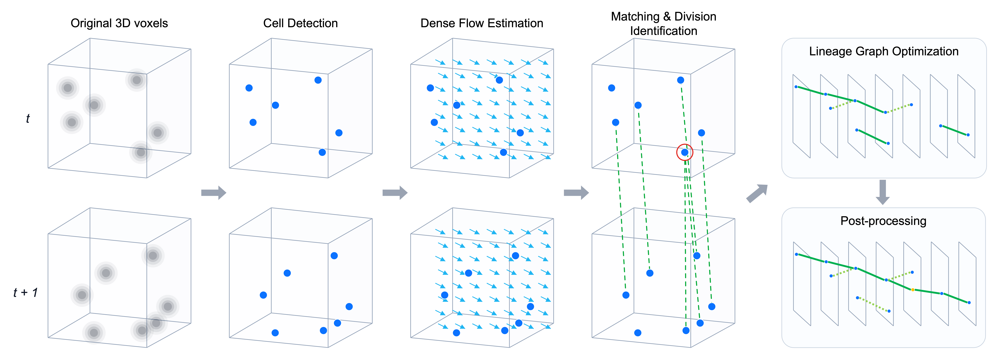

Thank you to the organizers and to everyone who shared discussions and notebooks. Our solution focused on detecting cells from sparse annotations and combining motion and division evidence into a consistent lineage graph.

## 1. Overview

Our pipeline has six stages:

1. **Cell detection:** ensemble heatmaps from 2.5D U-Nets and a 3D SegResNet to detect cell centers.
2. **Dense flow:** estimate a 3D displacement field between consecutive frames.
3. **Cell matching:** score candidate correspondences using image features and positions corrected for motion.
4. **Division identification:** identify dividing parents from original and motion-aligned images, with auxiliary models for the stages before and after division.
5. **Lineage graph optimization:** jointly select ordinary links and division events.
6. **Post-processing:** fill short gaps, remove small components, and refine node coordinates.

We put particular effort into detection accuracy because every downstream stage depends on the detected cells. For tracking, we trained the flow, matching, and division models separately, then combined their outputs through graph optimization to determine the connections between cells. Our final submission used an ensemble of relatively large detection backbones, and detection accounted for 55% of the total runtime.

Our final solution achieved a CV score of **0.977801 (0.540107)**, a public leaderboard score of **0.977 (0.52)**, and a private leaderboard score of **0.967 (0.47)**. Values in parentheses indicate Division Jaccard.

The trained model weights and calibration models for the reproduction package are publicly available on [Kaggle](https://www.kaggle.com/datasets/ren4yu/biohub-sub046-artifacts/).
An inference notebook for the test data is available on [Kaggle](https://www.kaggle.com/code/ren4yu/biohub-inference-run).



## 2. Data and Validation

The training set contains 199 videos cropped from two embryos. Each video has 100 frames of 64 × 256 × 256 voxels. Voxel spacing is 1.625 µm along z and 0.40625 µm along x and y, so we compute distances in physical coordinates.

The main challenge is that the annotations cover only a small fraction of the cells. There are approximately 133,000 annotated nodes, about 2.8% of the total estimated by the organizers. Many clearly visible cells have no annotation, and the training set contains only 151 annotated divisions.

This sparsity also matters for evaluation. The official score is the sum of the node-count-adjusted edge Jaccard and 0.1 times the division Jaccard. Links entirely within unannotated regions are not automatically false positives; incorrect links that compete with annotated connections are penalized. A separate adjustment accounts for the number of predicted nodes. Detection precision or local link classification accuracy alone therefore does not describe the final score.

We used five-fold cross-validation at the video level, distributing videos from both embryos across the folds and keeping all frames of a video together. We generated out-of-fold (OOF) predictions for the detectors, matcher, and division models. The downstream calibration models were also trained with the evaluation fold excluded. Two exceptions apply. The dense flow model is a single model shared by all folds, trained on its own split of 179 training and 20 validation videos. For the division models, each fold's checkpoint was selected by validation metrics on that fold's held-out videos, so the evaluation videos also took part in that model selection.

Both test embryos are different from the training embryos. We considered training on one embryo and validating on the other, but used video-level five-fold CV for model selection based on the improvement trends observed in CV and on the public leaderboard. Crops from the same embryo can overlap in space and time across folds, so this validation is not fully independent. Agreement with the public leaderboard also does not establish generalization to the private test embryo.

The four embryos are summarized below. Training prefixes and video counts come from the provided data; test prefixes, counts, density ranges, and public/private split assignments were identified through probing.

| Embryo prefix | Videos | Split | Density p10 | Density p50 (median) | Density p90 |
|---|---:|---|---:|---:|---:|
| `44b6` | 71 | Train | 134 | 355 | 627 |
| `6bba` | 128 | Train | 54 | 114 | 445 |
| `fdad` | 60 | Public test | [40, 60) | [160, 260) | [260, 420) |
| `ea36` | 106 | Private test | [40, 60) | [60, 100) | [160, 260) |

Here, density means **detections per frame**, used as a proxy for the number of cells. Using the same early version of our detector for all videos, we counted detections in four evenly spaced frames per video, averaged the counts, and computed percentiles across videos. Training values are rounded measurements, while test values are intervals inferred from probing. The public and private test embryos differ substantially in cell density.

## 3. Cell Detection

### Backbones

We combined 2.5D and fully 3D detectors.

For the 2.5D models, we reused the backbone architecture from our [CZII - CryoET Object Identification solution](https://www.kaggle.com/competitions/czii-cryo-et-object-identification/writeups/yu4u-tattaka-4th-place-solution-source-codes-submi). A pretrained 2D encoder extracts features from z slices, features are pooled along z at each stage, and a 3D decoder combines them. We used EfficientNetV2-L and EfficientNet-B7 encoders.

Each encoder input stacks three neighboring z slices as channels, allowing the first layer to use local depth information. These slices provide spatial context only; temporal information is introduced later in the tracking pipeline.

The fully 3D detector uses MONAI's SegResNet implementation, a residual encoder-decoder built from 3D convolutions. We used 32 initial channels, four encoder stages with one residual block per stage, and Group Normalization.

The submission used the following ensemble:

| Detector | Architecture | Heatmap weight |
|---|---|---:|
| EfficientNetV2-L | 2.5D U-Net | 0.3 |
| EfficientNet-B7 | 2.5D U-Net | 0.4 |
| SegResNet (MONAI) | 3D residual encoder-decoder | 0.3 |

### Training with sparse annotations

The target heatmap places a Gaussian with a standard deviation of 2 µm at each annotated center. Applying MSE directly to this target would also train the detector to predict zero at unannotated cells.

To avoid treating these cells as negatives, we extracted candidate centers using Difference of Gaussians (DoG) with a low threshold. We excluded regions within 6 µm of unmatched candidates from the loss. DoG candidates within 2 µm of an annotated center were treated as duplicates and did not create exclusion regions. Positive regions around annotated centers remained supervised even when they overlapped an exclusion region. DoG thus identified uncertain background regions to mask, without adding positive pseudo-labels.

We averaged MSE separately over positive and background regions, with a background weight of 0.5. This prevents the much larger background volume from overwhelming the supervision around cell centers.

Image intensities were normalized using the 0.1st and 99.9th percentiles of each video. Training crops were 48 × 192 × 192 voxels. Augmentations included random flips along y and x, random 90° rotations in the xy plane, intensity changes, and blur.

Arbitrary-angle rotation and scaling augmentations degraded performance in our experiments.

### Inference

For each detector, we averaged heatmaps from the five fold models and used two test-time views: the original image and an image flipped along x. We combined the detector heatmaps with the weights above, then extracted centers using non-maximum suppression with a `(3, 7, 7)` kernel and a threshold of 0.2.

### A0: Detection with geometric linking

The baseline in Table 1 links detections in consecutive frames using physical distance and a one-to-one Hungarian assignment with a 7 µm distance gate. We estimate collective translation, or drift, from the median displacement of matched points and repeat drift correction and assignment twice.

This baseline uses no dense flow, learned matcher, division predictions, or post-processing. Simple linking provides a starting point for evaluation: detections alone cannot produce true positive edges, while ordinary links can earn an edge score without predicting divisions.

## 4. Dense Flow and Cell Matching

### A1: Dense flow

Cells move both individually and collectively. We estimate flow from consecutive 3D images to predict where each cell will move in the next frame.

Downsampling by `(z, y, x) = (1, 4, 4)` gives an isotropic grid with 1.625 µm spacing. A small 3D encoder-decoder operates on this grid. Local correlations and a soft-argmax produce an initial displacement, which the network refines with a residual prediction. The encoder uses 32, 64, and 128 channels without normalization layers.

On real image pairs, training combines image and local feature consistency after warping, forward-backward consistency, and smoothness losses. We also directly supervise displacement on synthetic pairs generated with known translations and smooth deformations. Annotated links are used for endpoint-error evaluation and checkpoint selection, but not in the training loss.

The estimated flow supports both correspondence search and alignment of the images supplied to the division model.

In A1, we add dense flow to the source coordinates, estimate residual drift twice, and retain the same 7 µm gate and one-to-one assignment as A0. This measures the effect of motion compensation before introducing division modeling.

### A2: Cell matching

The matcher takes two consecutive frames and their detections, and scores which cells correspond across time. It uses appearance and positions corrected by flow to predict candidate correspondence scores and a null score representing the absence of a match. These scores narrow the candidate set; graph optimization later selects the final connections.

The matcher has its own 2.5D U-Net with an EfficientNetV2-S encoder, separate from the detectors. It uses the same `(1, 4, 4)` downsampling as the flow model. We sample 64-channel features at each detection from an intermediate decoder stage, avoiding computation of the full-resolution decoder output.

Self-attention and cross-attention process cell features and positional information. The matching head refines scores based on appearance cosine similarity and uses role embeddings to distinguish the two frames. It also predicts the null option.

For training, detections matched to annotated cells act as anchors, and annotated edges provide targets for bidirectional cross-entropy. Unannotated cells remain competing candidates, but absence of annotation does not make them null targets. For a dividing parent, we construct a target for each daughter and exclude the other daughter from the negative set.

For ordinary links, we retain candidates among the matcher's top five probabilities whose distance after flow compensation is at most 12 µm. We pass their ranks, forward and reverse probabilities, and margins over competing candidates to the next stage.

In A2, we use these candidates and scores in a Hungarian assignment. A0 and A1 consider all pairs within 7 µm after drift correction; A2 applies the same gate to the matcher candidates. The A1-to-A2 change therefore includes candidate filtering. In the complete pipeline, joint graph optimization replaces this local assignment and uses candidates within the 12 µm flow distance gate.

## 5. Division Identification (A3)

The division model predicts whether a detected cell will split into two daughters in the next frame, using 3D images from neighboring time points. We call this the **parent model**. Its output is combined with matching scores and daughter geometry, and graph optimization chooses the parent-to-daughter connections.

Both division and ordinary motion change the appearance of a local image region. To help distinguish them, we align the neighboring frames to the central frame before passing them to the model. We also retain the original images because a single displacement field cannot fully represent a one-to-two split.

The main parent model receives five volumes from three time points:

```text
[original t−1, t−1 aligned to t, t, t+1 aligned to t, original t+1]
```

The division model uses `(1, 2, 2)` downsampling. When converting flow to this grid, we account for both displacement units and voxel-center offsets introduced by pooling. We sample the next frame using forward flow. For the previous frame, we approximate the inverse displacement by negating the preceding forward flow field.

A shared EfficientNetV2-S encoder processes each input. Features from corresponding stages are concatenated in input order and passed to a 3D decoder with Group Normalization. The decoder predicts a parent score at each detection. The flow model remains frozen.

Positive examples are annotated parents with two children in the next frame. Negatives include ordinary continuing cells and daughters immediately after division. Detections without a GT match do not enter the negative loss. We average positive and negative BCE separately. During training, 25% of samples come from frames containing positive parents, 25% from hard-negative frames around divisions, and the remainder from ordinary sampling. We use AdamW with a learning rate of 1e-4, 20 epochs, and EMA decay of 0.995.

We also use independent **pre** and **post** models. For a division with the parent at time t and daughters at t+1, pre identifies the precursor at t−1, while post identifies the daughters at t+1. Each model receives three original frames centered on the cell's evaluation time. Their scores provide additional evidence for division candidates.

The submission uses the parent model with both original and aligned images to build the primary division candidate pool. A second parent model takes only three original frames. Its scores, together with pre and post scores, support ordinary-link calibration and an additional division candidate pool with a 16 µm radius. The two division pools are calibrated separately. Division inference averages five fold models and four rotations in the xy plane; OOF evaluation uses the corresponding held-out model for each video.

## 6. Lineage Graph Optimization (A3)

### Calibrating candidate scores

We combine distances and model outputs to estimate probabilities for ordinary links and division candidates. These probabilities let the graph optimizer compare competing choices.

Candidates are either ordinary links or division events consisting of one parent and two daughters. A parent score threshold of 0.1 controls division candidate generation; final selection is handled by the optimizer.

Calibration features include distance, bidirectional matching scores, candidate ranks, margins, detection confidence, and parent/pre/post scores. We aggregate pre evidence over several possible predecessors. Examples include the maximum of the pre score multiplied by the matching probability, and an average weighted by matching probabilities.

To handle sparse annotations, we estimate two probabilities:

- **Probability of being evaluated:** whether a candidate is subject to scoring given the available annotations.
- **Conditional probability of being correct:** whether it is a true positive, given that it is evaluated.

Writing these as a and q, we use `a × q` as the expected true-positive contribution and `a × (1 − q)` as the expected false-positive contribution. This avoids treating all unevaluated candidates as errors during training.

Ordinary links use logistic regression. For the conditional division probability, we train LightGBM and XGBoost from a linear model's initial logit and average their predicted probabilities with equal weights. The primary and additional division pools have separate models. Features include aggregated predecessor evidence, motion, and daughter separation. We retain the LightGBM probabilities for constructing the initial graph and use the averaged probabilities when evaluating choices during optimization. Division calibration targets require exact matches to the parent and both daughters, which differs from the official metric's local lineage criterion.

### Selecting links and divisions jointly

If ordinary links are fixed first, a correct daughter may be assigned to another parent, preventing a valid division from being added later. We therefore jointly choose which nodes to retain, which ordinary links to use, and which daughter pairs to select as divisions.

The main constraints are:

- Each cell has at most one parent.
- Each cell has at most one outgoing event: an ordinary link or a division.
- A division selects both daughters together.
- A dividing parent must have an ordinary incoming link, and each daughter must have an ordinary outgoing link.
- A daughter cannot divide again at the immediately following time boundary.

The last two constraints reflect the temporal resolution of this dataset. They also prevent implausible divisions from supporting one another and strengthen the LP relaxation.

The objective is a surrogate of the competition metric computed from expected true positives, false positives, and node counts. We linearize it around the current solution to obtain rewards for true positives and costs for false positives and nodes. We optimize each video using these coefficients, aggregate expected counts across videos, and update the coefficients for up to three rounds. We accept an updated solution only if it improves the surrogate objective.

We use HiGHS, first solving the linear programming (LP) relaxation. If fractional decisions remain, we solve a mixed-integer linear program (MILP) with binary division variables. If the time limit is reached, we retain a feasible solution. Optimization uses predicted probabilities; the resulting graphs are evaluated separately with the official scoring implementation.

## 7. Post-processing

### A4: Gap closing

To recover temporarily missed cells, we connect track endpoints to the starts of later tracks. We estimate collective motion from selected links, compensate for it, and use Hungarian assignment to select connections.

We process gaps of one, two, and three missing frames in that order. For g missing frames, the distance gate is `3√(g+1)` µm. We insert nodes by linearly interpolating between the original endpoint coordinates.

### A5: Short component removal

After gap closing, we remove weakly connected components with fewer than six nodes. Gap closing comes first because a short fragment may become part of a longer track once missing detections are filled in.

### A6: Affine refinement of detected coordinates

Even with correct connections, localization jitter can affect matching to GT points. We refine coordinates while holding the graph connections fixed.

For each pair of consecutive frames, we fit an affine model that predicts displacement from position using ordinary links. A quadratic optimization then balances consistency with the predicted motion against staying close to the original detection coordinates. Link weights are the calibrated conditional probabilities of being correct.

We keep division parents and daughters, gap endpoints, and interpolated nodes fixed. Refined positions are rounded to integer voxel coordinates. Changes that leave the volume or create coordinate collisions within a frame are rejected. Node counts and edges remain unchanged.

### A7: Affine refinement of interpolated coordinates

We then refine the nodes inserted into gaps using the same affine motion fields, fitted from ordinary links before coordinate refinement. Starting at one endpoint, we propagate positions through the motion fields and distribute the final endpoint discrepancy linearly across the gap so that both endpoints are preserved.

Only the interpolated nodes move in this step; detected nodes, gap endpoints, and graph connections remain fixed. We again round coordinates and reject out-of-bounds positions and collisions. The submission uses both A6 and A7.

## 8. Submission and Results

We accelerated inference with TensorRT for the detectors and division models, mixed precision, and parallel execution on two GPUs. The matcher computes only the intermediate features it needs, and the flow fields are reused for matching and division-image alignment. Division models also reuse encoder features of original frames across overlapping temporal windows. We reuse these features in the models that take three original frames and in the original-frame branches of the parent model. The latter additionally processes aligned images.

Our final solution achieved a CV score of 0.977801 (0.540107), a public leaderboard score of 0.977 (0.52), and a private leaderboard score of 0.967 (0.47). Values in parentheses indicate Division Jaccard.

**Table 1. Building the complete pipeline.** Starting from A0, we progressively add or replace stages to reach the final configuration. Every row starts from the same OOF detections for all 199 training videos, with the videos, folds, and scoring implementation fixed. Optimization and post-processing can change which nodes are retained, add interpolated nodes, and refine coordinates.

| ID | Configuration / change | Adjusted edge Jaccard | Division Jaccard | Total score |
|---|---|---:|---:|---:|
| A0 | Detection + Hungarian assignment with drift correction | 0.890211 | 0.000000 | 0.890211 |
| A1 | + Dense flow for motion compensation | 0.901919 | 0.000000 | 0.901919 |
| A2 | + Matcher candidate filtering and correspondence scores | 0.901953 | 0.000000 | 0.901953 |
| A3 | + Division models and calibration; joint link/division optimization replaces Hungarian assignment | 0.911017 | 0.534759 | 0.964493 |
| A4 | + Gap closing | 0.916111 | 0.534759 | 0.969587 |
| A5 | + Removal of components with fewer than six nodes | 0.918105 | 0.531915 | 0.971297 |
| A6 | + Affine refinement of detected coordinates | 0.923141 | 0.540107 | 0.977151 |
| A7 | + Affine refinement of interpolated coordinates: complete pipeline | 0.923790 | 0.540107 | 0.977801 |

The total score is `Adjusted edge Jaccard + 0.1 × Division Jaccard`. A0–A2 produce no branches, so their division scores are zero. Because ordinary-link calibration also uses parent, pre, and post features, A3 introduces division modeling and graph optimization together.

The Hungarian cost is the corrected distance d in A0 and A1, and `d + 12(1 − p)` in A2, where p is the matching probability. A0–A2 retain all detections, including isolated ones. Moving from A2 to A3 also changes the candidate gate from 7 µm to the final 12 µm flow distance gate, alongside calibration, division modeling, node selection, and joint optimization.

Adding flow and matching scores to Hungarian assignment produced modest gains. The larger improvement came at A3, when division models, calibration, and joint optimization were introduced. Distances after flow compensation and matching scores also provide evidence to the downstream calibration models, which in turn guide the LP's selection of connections. The gains at A1 and A2 alone therefore do not capture their full role in the pipeline. We interpret the A3 improvement as the combined benefit of these features, division evidence, and graph constraints. Gap closing, component removal, and coordinate refinement further improved the final score.

## 9. What Didn't Work

All numbers below are differences in the official score on the 199-video OOF evaluation unless noted. Two measurement lessons apply to every stage. First, training-time validation metrics did not track the official score: a 12-video mini-validation repeatedly inverted the sign of the full OOF result for detectors, and no division-model validation metric reached a Spearman correlation of 0.7 with the final score. Second, retraining the same division recipe with a different seed moved the score by 0.003, so single-seed differences below that were treated as noise, and we also rejected changes whose sign differed between the two training embryos.

### Cell detection

- **Other encoders.** ConvNeXt (v1, v2 base and large, DINOv3), CAFormer, CoAtNet, ResNet-RS, and EdgeNeXt trained as 2.5D U-Nets did not beat EfficientNetV2-L or EfficientNet-B7 on OOF, and most needed fp16 guards to train at all. ConvNeXtV2-large matched a single EfficientNet model, but adding it to the ensemble lost 0.003 in the full pipeline because division true positives dropped.
- **Fully 3D networks on the same targets.** nnU-Net (3d_fullres, ResEnc-M) was 0.022 below the 2.5D model. 3D U-Net, MedicalNet ResNet34, and a self-supervised SwinUNETR were 0.017 to 0.03 below. Averaging a weaker 3D heatmap into the ensemble hurt; only SegResNet with EMA reached near parity and helped as a member.
- **Temporal context inside the detector.** Two-frame inputs (channel concatenation or cross-attention), flow-warped t±1 planes, and raw t±1 planes all stayed within noise. The cells we hoped to recover (dim cells) got worse, because the flow field shares the detector's blind spots.
- **Heatmap target and loss.** Sigma 3 µm lost 0.025; anisotropic or voxel-isotropic sigmas lost 0.005 to 0.019. Restricting the loss to an 8 µm ball around annotations lost 0.008 and inflated the node count, so far-background negatives are needed. Removing the DoG exclusion lowered recall. A learned peak-prominence loss lost 0.004 as an auxiliary term.
- **Augmentation.** Rotation plus scaling lost 0.015. Mixup, Gaussian noise, extra blur, intensity bundles, and hard-negative crop sampling were neutral or negative.
- **Pseudo-labels and distillation.** OOF pseudo-positives from our own detector gave +0.009 on one fold, which disappeared with a fold-clean teacher: the entire gain was leakage. Distilling the adopted ensemble into a student gave +0.005 to +0.009 with leaky targets and −0.003 to −0.014 with leak-free per-fold targets. Point pseudo-labels from the final graph raised single-model edge Jaccard by 0.016 but increased node count by 5–7%, so the score tied. Co-training with external dense labels (NISNet3D, synthetic volumes) lost 0.003 to 0.028.
- **Test-time augmentation.** Gains shrank as models got stronger: flip or rotation TTA on a strong single model was −0.003 to +0.0002, and a D4 union with NMS lost 0.014. Only flip TTA on all three members together was positive, and its confidence interval included zero.
- **Threshold and NMS.** The threshold sweep peaked at 0.2 for every detector generation. Lowering it to 0.10 and recalibrating through the full pipeline lost 0.005 because the node-count adjustment outweighed the extra true positives. Per-video quantile thresholds lost 0.013. Adding low-confidence nodes with a dedicated calibrator gained at most 0.001 and was negative on one embryo. Sub-voxel centroid refinement lost 0.001.
- **Long schedules and precision.** Four times the epochs with EMA 0.998 lost 0.015. fp16 inference without heatmap smoothing lost 0.03 (bf16 lost 0.196); a sigma 0.7 blur restored fp32 results.

### Dense flow estimation

- **Pure self-supervision collapsed.** Photometric, census, cycle, and descriptor losses alone converged to zero flow. Synthetic translation and smooth deformation supervision was required to get a non-trivial field. The self-supervised loss also could not select checkpoints; endpoint error on annotated links was needed.
- **Better endpoint error did not mean a better score.** Reducing endpoint error by 9% (the largest single improvement) changed the edge score by +0.0001 and the total by −0.0005. The oracle motion prior is worth +0.008, while the oracle detection position is worth +0.040; learned flow recovers about a quarter of the motion ceiling.
- **Flow did not let us tighten gates.** With flow in the assignment distance the optimal gate stayed at 5.5 µm. Residual or clipped forms (drift plus clipped flow deviation) were worse the tighter the clip, converging to plain drift.
- **Retraining downstream models in the flow frame.** The matcher retrained with flow-compensated positions gained 0.0003; frame-skip augmentation via composed flow lost 0.003. Using the flow encoder as a detector backbone lost 0.02.
- **Flow in the division model.** Warped neighbours without the raw frames lost 0.0013 despite a +0.07 validation AP; warped inputs for the pre and post models lost 0.004; warping in feature space lost 0.002; a t±2 warp window was negative. Only the raw-plus-warped five-volume input survived.
- **Flow for gap closing.** Advected flow residual features, flow-gated candidates, curved interpolation along trajectories, Hermite interpolation from endpoint velocities, and long gaps of four to five frames via composed flow were all within ±0.0003 or negative. Diagnostics showed why: flow error at annotated positions was 1.9 µm, but the residual between detections was 7.0 µm, so the limiting factor is detection displacement, not motion.
- **Flow for coordinate refinement.** A per-frame translation estimated from the selected links matched the dense field exactly (difference 0.000001), and a per-frame affine fit was slightly better. The final smoother therefore reads no flow.
- **External synthetic data** had motion almost entirely along z (median |dz| 1.38 µm versus 0.3 µm in-plane, the voxel aspect ratio), so it would have taught a wrong motion prior and was not used.

### Cell matching

- **Where the matcher's value sits.** Replacing distance by matcher scores inside Hungarian assignment changed the score by +0.00003 (Table 1, A1 to A2). Only 9 of 9,527 false-negative edges were ranking failures. In isolation, distance-only scoring even had higher held-out AUC. Yet removing the matcher from the graph optimizer lost 0.002: its probabilities matter for competition between candidates during calibration and optimization, not for candidate generation.
- **Larger trunks.** A 3D SwinUNETR trunk lost 0.003 at five times the training time. EfficientNetV2-L lost 0.0001 to 0.0026 versus V2-S. A SegResNet trunk initialized from the detector lost 0.0025 despite the best diagnostic numbers. Higher-resolution (1,2,2) features did not change edge results at 2.4 times the cost. Frozen detector features lost two points of top-1 accuracy: detection features lack identity information.
- **Matching heads.** A SuperGlue-style cosine head with temperature and dustbin reached the best top-1 accuracy (97.3%) but lost 0.008, because its probabilities were poorly calibrated and the confidence gate recovered 8 instead of 130 true positives. A fixed temperature collapsed training. Depth, width, dropout, relative position bias, and ALiBi were flat; width 256 overfit.
- **Division heads on the matcher.** Node classification, fork, and sibling-pair heads reached AUC 0.53 to 0.78 and AP below 0.01; all fifteen variants were below the production rule.
- **Training targets.** Auxiliary BCE on hard examples mined from the optimizer was neutral. Simulating missing cells by deleting inputs instead of masking target columns lost 0.005 (seven fewer divisions). Oversampling divisions, dropping anomalous ground-truth links, adding detector confidence as input, and reducing the candidate radius from 16 to 12 µm were neutral or negative.
- **Temporal context.** Training on (t, t+2) pairs lost 0.002, and a zero-shot two-frame model matched the trained one on two-frame gaps.
- **Ensembles and TTA.** A 2.5D plus 3D matcher ensemble was ±0.0002. Flip TTA lost 0.003 and rotation TTA lost 0.005: the edge term improved slightly, but averaged probabilities weakened the daughter-competition features that the division calibrator uses.
- **Embeddings elsewhere.** Matcher embeddings in link calibration, gap-endpoint similarity, and ArcFace track-identity embeddings were all within noise or negative (down to −0.003 on the clamped score).
- **Retraining on new detections.** Four retrains on new detector ensembles stayed within ±0.001 of the zero-shot matcher, so we reused it.
- **Gates.** Lowering the probability gate was monotonically negative (−0.004 at 0.1): unreachable annotated pairs had probability below 0.1 in 68% of cases. The Hungarian gate grid (84 cells) was flat within 0.0003.

### Division identification

- **What is at stake.** Replacing parent scores with ground truth gave +0.0095 with the calibrator fixed, +0.018 with the calibrator refit, and +0.025 with ground-truth daughter pairs. The whole stage therefore had 0.01 to 0.025 of headroom left, and a global top-5000 candidate oracle reached only 47 of 150 divisions.
- **Validation metrics misled.** Across 28 variants, validation AUC had a Spearman correlation of 0.09 with the final score. A +0.035 AP turned into −0.0027, a +0.10 AP left division true positives unchanged, and an Optuna-tuned calibrator with the best proxy value lost 0.0016. Best-AUC epochs were single-epoch spikes on 24 to 36 validation positives, so we selected checkpoints with a calibration gate on score medians instead.
- **Backbones.** Swin V2, CAFormer S18 and S36, CoAtNet, EfficientNet-B0, EfficientNetV2-L, ConvNeXt (DINOv3 and V2), ResNet-RS, SegResNet trained from scratch or from detector weights, a FlowNet3D-style 3D model, and a second-stage crop classifier on top-K candidates all tied or lost (−0.002 to −0.02). Only CoAtNet-nano tied with EfficientNetV2-S.
- **Training knobs.** Learning rate, 30 epochs, EMA decay, weight decay, stochastic depth, batch size, encoder learning-rate multipliers, frozen encoders, and checkpoint averaging were within noise or negative. A negative-class weight of 2 lost 0.015 (true positives 80 to 53), scale_pos_weight 10 in the calibrator lost 0.010, focal loss lost 0.002 and broke the calibration gate, and event-window sampling lost 0.007. Rotation, scaling, z-flip, masked-frame self-supervised pretraining, and the detector heatmap as an extra input channel were negative.
- **Pseudo-positives.** Adding 207 image-reviewed unannotated parents raised AP by 0.035 and lost 0.0027: the accepted examples already had parent scores above 0.94, so they were easy cases. Curricula, distillation from the base model, and 36 reviewed temporal negatives (−0.005) did not help. In a blind review, 11 of 30 non-branching annotated chains looked like divisions, so sparse ground truth cannot certify negatives and pseudo-label precision could not be estimated.
- **Multitask and auxiliary targets.** A joint parent/pre/post trunk lost 0.0035 to 0.0098; a successor-offset auxiliary head lost 0.002 to 0.005.
- **Temporal windows.** t±2 inputs lost 0.001; shifted windows for pre and post models lost 0.001 to 0.003.
- **TTA and ensembles.** Rotation TTA gained 0.001 with a confidence interval including zero at four to eight times the cost, and TTA stacked on a model ensemble added nothing. Backbone ensembles were graph-dependent, and the average of two seeds of one promising ensemble fell below the baseline.
- **Candidate pool.** Lowering the parent threshold from 0.5 to 0.1 only paid off once nonlinear calibration existed (0.9706 versus 0.9693); before that it lost 0.013, partly because a timed-out MILP returned a worse interior solution.
- **Calibration models.** Every one-variable LightGBM sweep was at or below the baseline. XGBoost alone lost 0.0013, and the adopted 50:50 average gained 0.0003 with a confidence interval touching zero. Teachers built from local lineage context lost 0.003 to 0.004: 17 selected divisions that are strict-target negatives were counted as true positives by the official metric, 14 of them one frame off. Replacing the parent score used by ordinary-link calibration lost 0.001 to 0.003.

### Graph optimization

- **Off-the-shelf ILP weights.** The public tracksdata ILP (appear 0, disappear 1.5, division 1.0) lost 0.001 versus Hungarian with short-component removal. Ultrack zero-shot reached edge Jaccard 0.63 and 0.42 on two sample videos, versus 0.96 and 0.99 for our detections with geometric linking.
- **Node price without component removal.** A metric-derived LP with only a node price raised edge Jaccard by 0.003 but increased node count by 6.5%, so the total fell; a tenfold price collapsed to 0.836. Prices prune whole tracks rather than short junk, so short-component removal remained necessary.
- **Partial joint optimization.** Freezing tracklets and selecting gaps and divisions gained 0.001 with a confidence interval including zero. Rewiring ordinary links with calibrated probabilities but adding divisions afterwards lost 0.0003. The gain of the adopted formulation came from selecting daughter pairs jointly.
- **A single division price** inside the wiring LP, before calibrated probabilities existed, lost 0.012 to a five-gate rule.
- **Constraints.** Requiring low-confidence nodes to have both in- and out-links lost 0.0008. Forcing daughter tracks to be at least 10 nodes long lost 0.011, dropping true and false divisions together. Charging the LP for short components that survive removal was negative, because the expected true positives of rescued components were over-predicted twofold.
- **Density-aware prices.** A per-video node price was neutral, and a video-density feature in the calibrators lost 0.004. A per-embryo price gained 0.0004.
- **Solver tuning.** Warm starts changed nothing. Reducing MILP time-outs from 55 to 6 solves improved the LP objective and lost 0.0016: a better surrogate optimum is not a higher official score. A third coefficient-update round changed the objective by 3e-8.
- **Calibration features and models.** LightGBM for low-confidence edges (−0.0004), tree-based exposure (−0.002), appearance embeddings, temporal anchors, annotation-rate offsets, cross-embryo calibrators, and path-replacement calibration were all within noise or negative. In the last case, only 160 of 24,353 candidates changed any true or false positive, and the predicted false-positive change (−10) had the wrong sign (actual +31).
- **Thresholds as Lagrange prices.** The derivation is exact, but its prediction that cutting low-confidence nodes is cheap was contradicted: losses are super-linear because dropping one node fragments a track that is then removed as a short component. Link scoring beyond flow-compensated distance was exhausted by four independent measurements, but the matcher probability still earns 0.0012 inside the optimizer.
- **Clamped versus unclamped scores** diverge whenever node counts move (24% of videos had a node ratio below −0.05); we only adopted changes that improved both.

### Post-processing

- **Longer gaps.** Reaching four or five missing frames lost 0.0004: for g = 4 there were 12,000 unannotated bridges against 28 backed by ground truth, so the node-count penalty cancels the gain. Four- and five-frame gaps via composed flow added 67,000 nodes for −0.0002. With eligibility fixed, extending the reach to infinity is worth only +0.0017.
- **Smarter gap selection.** Matcher-embedding cosine as a gate or cost (±0.0001; appearance AUC for bridge correctness 0.67), a learned bridge selector (AUC 0.66 for both endpoints being annotated), image-support features, joint LP with low-confidence detections (−0.0002), and reassigning endpoints after coordinate refinement (zero improving exchanges out of 46) did not help. A ByteTrack-style extension of track ends to low-confidence peaks lost 0.001 to 0.003.
- **Cut-and-relink.** The oracle for relinking across wrongly continued tracks is +0.0095, but the wrong links sit at matcher probability 0.94 and are separable from true links only at AUC 0.76, far below the 0.95 needed to break even.
- **Interpolation.** Snapping gap nodes to nearby low-confidence detections (+0.00001), flow integration, Hermite interpolation from endpoint velocities (−0.0007), intensity-centroid correction, and learned interpolation coefficients (coordinate MSE improved, score flat) did not beat linear interpolation followed by affine propagation.
- **Coordinate refinement variants.** Translation, rigid, and affine motion models were within each other's confidence intervals. Dense-flow blends, confidence-weighted retention, axis-specific strengths (below a permuted control), and Huber-robust fits were neutral or negative. Releasing gap endpoints (−0.0004), adding gap-spanning constraints (−0.0006), releasing division nodes (−0.0008), and adding a per-track residual velocity (−0.00005 despite better displacement MSE) all lost. Re-matching ordinary links after refinement selected 7 of 3.3 million swap candidates, all neutral.
- **Frozen frames.** Anchoring coordinates on duplicated frames gained 0.0007 on training data but was not adopted: probing showed the test embryos have no frozen frames, and 947 of 947 frozen pairs in training belong to one embryo.
- **Component filtering.** Threshold 5 instead of 6 lost 0.0003 while adding 62,000 nodes; no removal lost 0.002 to 0.003. Rescuing high-confidence short components (+0.00005), rescue inside the LP, and exempting lineages through the crop centre (upper bound +0.0007) did not help. The mechanism: removal drops 771 true positives, but re-matching recovers 431, and re-inserted nodes compete again for annotation matches.
- **Localisation headroom.** Snapping every matched detection to its annotated position is worth +0.030, but 96% of that sits in the 10% of points with errors above 3 µm, mostly a two-slice z offset on dark, z-flat cells that every detector reproduces (sign agreement above 90%). Fixing only the sub-3 µm bulk improved edges by 0.003 but cost eight divisions, for a net −0.003. Coordinate work realised about 0.0055 of the 0.030.
- **Embryo disagreement.** Gap closing's gain itself was skewed (+0.020 on one training embryo, +0.0025 on the other), and most rejected post-processing candidates in the +0.0001 to +0.0003 band had opposite signs on the two embryos. Since the hidden test embryos differ in density from both, only changes positive on both embryos and all five folds were adopted.
